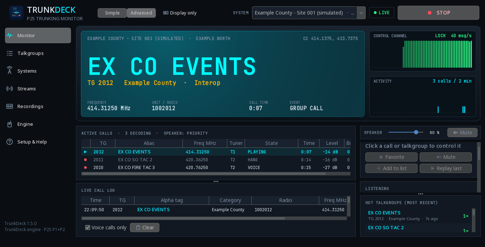
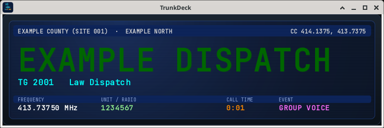
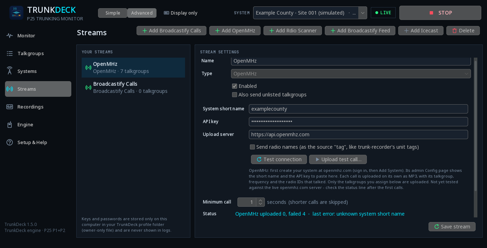
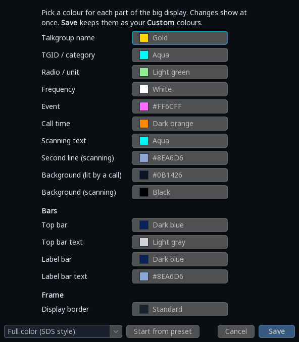

# TrunkDeck

**A scanner-style P25 trunking monitor for Windows and Linux.** TrunkDeck follows a P25 trunked radio system's control
channel, decodes the voice calls (Phase 1 and Phase 2) with its own built-in engine, plays them, records them, and can
stream them to Broadcastify, OpenMHz or your own Rdio Scanner server - all from one window, no other radio software needed.



> **Provided as-is.** TrunkDeck is a hobby project shared in the hope that it is useful. There is **no support and no
> warranty** of any kind, and issues or pull requests **may not be answered**. See [LICENSE](LICENSE).

## Features

* **Native P25 engine** (written in Java from the TIA-102 standards): Phase 1 control channel (C4FM, and LSM/CQPSK for
  simulcast with automatic selection), Phase 1 (IMBE) and Phase 2 TDMA (AMBE+2, both slots) voice, encryption and
  emergency flags, priority, talkgroup mute / lockout, radio-ID names (DSD+ `.radios` or CSV import).
* **Receivers:** one **Airspy R2** (about 8.8 MHz at 10 MS/s - often a whole site at once, many calls decoded in parallel)
  and/or one or more **RTL-SDR** dongles (a control dongle plus roaming voice dongles). Own drivers - no SDR# / SDRTrunk.
* **Big scanner display** with colour themes (Full color, SDS-style, amber, ... or your own colours, including the bars
  and the display border), glow, scan lines, backlight on calls, SCANNING ticker.
* **Display only** mode: the window shrinks to just the scanner display (resizable, draggable, always-on-top option);
  double-click to get the full window back. Everything keeps running.
* **System tray:** close or minimize to the tray (or to Display only) - your choice.
* **Streaming / uploads** (optional): **Broadcastify Calls**, **Broadcastify Feeds** / any Icecast server (MP3),
  **OpenMHz**, **Rdio Scanner**. Live talkgroup assignment, status and retry on the Streams page.
* **Now-playing tags** on Broadcastify Feeds / Icecast (1.5.1): the talkgroup (optionally the radio) of the call playing
  is sent as the stream title, in step with the audio - your choice of format, an optional text between calls, and a
  *Send test tag* button. A separate short request: the audio connection is never touched.
* Recordings of every call, call log, Active-calls table, control-channel decode meter, activity graph, per-call
  diagnostics, talkgroup CSV import (RadioReference format), Simple and Advanced views.

| Display only | Streams | Colours |
|---|---|---|
|  |  |  |

More: [Now-playing tags](docs/screenshots/now-playing-tags.png) · [Simple view](docs/screenshots/simple-view.png) · [Display only right-click menu](docs/screenshots/display-only-menu.png) · [Systems page](docs/screenshots/systems.png) · [Talkgroups page](docs/screenshots/talkgroups.png) · [Engine page](docs/screenshots/engine.png)

*All screenshots show a simulated signal and a fictional example system (made-up names, frequencies and IDs).*

## Install

Download the file for your system from the [Releases](../../releases) page.

### Windows 10/11 (64-bit)

1. Unzip **`TrunkDeck-1.5.1-windows.zip`**, open `TrunkDeck\windows` and double-click **`Install.bat`**
   (SmartScreen: *More info → Run anyway*). It downloads the Eclipse Temurin Java runtime into TrunkDeck's own folder
   (checksum-verified) and adds Start Menu and Desktop shortcuts. Installs for your user only, no admin rights needed.
2. **USB driver (once per receiver):** run [Zadig](https://zadig.akeo.ie), *Options → List All Devices*, pick the
   RTL-SDR (*Bulk-In, Interface (Interface 0)*, USB ID `0BDA 2838`) or the Airspy (`1D50 60A1`), choose **WinUSB**,
   *Replace Driver*, then replug the receiver.
3. Start **TrunkDeck** from the Start Menu.

Uninstall: *Settings → Apps → TrunkDeck*.

### Linux (Fedora, Ubuntu, Debian, Mint, Arch, Raspberry Pi OS 64-bit)

```bash
tar xzf TrunkDeck-1.5.1-linux.tar.gz
cd TrunkDeck/linux
./install.sh
```

The installer downloads the Java runtime (checksum-verified), adds an app-menu entry, a desktop shortcut and a
`trunkdeck` command, and offers to set up USB access (a udev rule for RTL-SDR and Airspy, and blocking the DVB-T driver
that grabs RTL-SDR dongles). Replug the receivers afterwards. The Airspy needs `libusb1` (`sudo dnf install libusb1`,
Debian/Ubuntu: `libusb-1.0-0`). GNOME needs the *AppIndicator* extension for the tray icon.

Uninstall: `~/.local/share/trunkdeck/uninstall.sh`.

### First start

1. **Systems** page: add your system - its control channel(s) in MHz (RadioReference lists them; use the ones marked
   *c*). The preloaded *Example County* presets are **fictional** placeholders; delete them if you like.
2. **Talkgroups** page: import your talkgroup CSV (RadioReference export works as-is; `talkgroups_template.csv` is a template).
3. **Engine** page → *Voice codec*: click **Build from source…** once to build the JMBE voice codec on your PC (see the
   legal note below). Without it, calls are followed but silent.
4. Plug in the receiver(s) and press **START MONITORING**.

The full manual (every page, streaming setup, Airspy notes, troubleshooting) is [stage/README.md](stage/README.md); it is
also included in the download.

## Build from source

You need a **JDK 22 or newer** (`javac` and `jar` on the PATH) and `bash` (on Windows: Git Bash or WSL).

```bash
bash build.sh            # compiles src/ into build/trunkdeck.jar
bash build.sh test       # ... and runs the automated tests (some are skipped without test recordings / a display)
bash assemble_pkg.sh     # assembles pkg/TrunkDeck (app, installers, licences, source)
python3 make_zip.py      # writes dist/TrunkDeck-<version>-windows.zip, -linux.tar.gz and SHA256SUMS.txt
```

Run without installing (Linux, with a system Java 22+): `bash pkg/TrunkDeck/linux/run.sh` after `assemble_pkg.sh`.
The bundled native libraries (`stage/native`) are prebuilt `librtlsdr` and `libusb`;
their source archives are in `stage/third-party`.

Optional test inputs (never committed, see `.gitignore`): public P25 sample recordings in `samples/`, your own
recordings via `-Dtrunkdeck.testdata=DIR`, your own DSD+ file via `-DradiosFile=FILE`, a JMBE jar via `-Djmbe=FILE`.
Tests that need them are skipped when they are missing.

## Legal

* **Only monitor and stream unencrypted traffic, and follow your local laws.** Receiving public-safety radio is legal in
  much of the US, but some states and countries restrict scanners (for example in vehicles) or the use or rebroadcast of
  what you hear. You are responsible for how you use this software. TrunkDeck does not decrypt encrypted calls.
* **Voice codec / patents:** TrunkDeck does **not** include a voice codec. On request it downloads the source of
  [JMBE](https://github.com/DSheirer/jmbe) (GPL-3.0) and compiles it on your computer, or uses a JMBE jar you choose.
  The IMBE and AMBE+2 vocoders it implements are subject to patents held by Digital Voice Systems, Inc.; check whether
  you need a licence where you live.
* Broadcastify, OpenMHz, Rdio Scanner, RadioReference, Airspy and RTL-SDR are names of their respective owners;
  TrunkDeck is not affiliated with or endorsed by any of them.

## License

TrunkDeck is released under the [MIT License](LICENSE) - Copyright (c) 2026 TrunkDeck contributors.
Bundled third-party components keep their own licences (FlatLaf, librtlsdr, libusb, java-lame, JTransforms, ...):
see [NOTICE.txt](NOTICE.txt) and [stage/licenses/THIRD-PARTY.txt](stage/licenses/THIRD-PARTY.txt).
