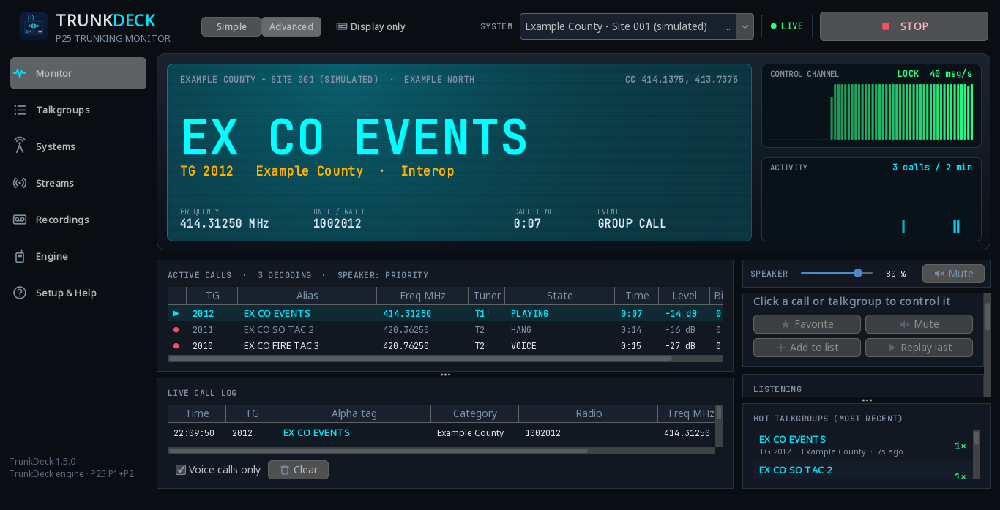
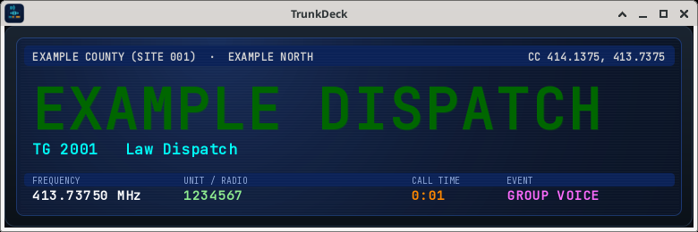
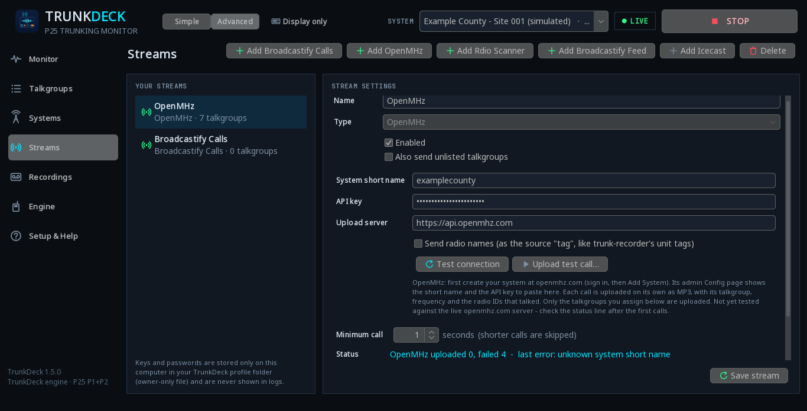
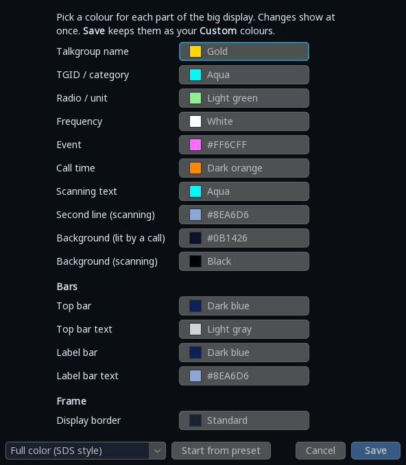

# TrunkDeck

**A scanner-style trunking monitor for Windows and Linux.** TrunkDeck follows a P25 trunked radio system's control
channel, decodes the voice calls (Phase 1 and Phase 2) with its own built-in engine, plays them, records them, and can
stream them to Broadcastify, OpenMHz or your own Rdio Scanner server - all from one window, no other radio software needed.
New and **untested**: DMR, NXDN, Motorola Type II (SmartNet / SmartZone) and analog FM systems.



### [⬇ Download TrunkDeck (Windows & Linux)](https://github.com/rcummings14/TrunkDeck/releases/latest) &nbsp;·&nbsp; [▶ Watch the 7-minute tour](https://www.youtube.com/watch?v=iAd6VPXa0ZE)

> **Provided as-is.** TrunkDeck is a hobby project shared in the hope that it is useful. There is **no support and no
> warranty** of any kind, and issues or pull requests **may not be answered**. See [LICENSE](LICENSE).

If TrunkDeck is useful to you, you can support it here: [https://paypal.me/TrunkDeck](https://paypal.me/TrunkDeck)

## What's new in 1.7.5 beta

* **More kinds of radio system** (all new and **untested** on real systems; please report how they work on
  [GitHub Issues](https://github.com/rcummings14/TrunkDeck/issues)). Choose them under **Kind** on the Systems page:
  * **DMR conventional:** channels with their colour code and timeslot (`450.0000:1/2`), or both timeslots.
  * **DMR trunked:** Tier III, Capacity Plus, Connect Plus and XPT.
  * **NXDN conventional and NXDN Type-C trunked:** NXDN48 and NXDN96 are detected automatically. Sites that use channel
    numbers take `number=MHz` entries (`37=451.0125`).
  * **Analog FM (conventional):** channels with names and an optional CTCSS (PL) tone per channel (`155.3700:100.0 Fire`),
    plus a squelch setting from 1 to 10.
  * **Motorola Type II**, described below.
  * DMR and NXDN voice use the AMBE+2 codec, so they need JMBE 2.x, the same as P25 Phase 2.
  * **Set up from RadioReference** now imports these system types too, instead of refusing them.
* **Motorola Type II SmartNet / SmartZone** (new, **untested**): a new system kind on the Systems page. TrunkDeck
  decodes the 3600 bit/s Type II control channel (with error correction; damaged messages are thrown away rather than
  misread) and follows each call. The grant says whether the voice is analog FM or P25. If TrunkDeck joins a call late,
  it uses the talkgroup's last known mode. Encrypted, emergency and patch flags and the talking radio's ID are shown.
  * **Band plan** setting: *Auto* covers 800 MHz (rebanded, standard and splinter, checked against the channel number the
    site announces) and 900 MHz. VHF / UHF systems need their base frequency, spacing and offset typed in
    (for example `136.0000, 12.5, 380`).
  * Tested only against simulated signals, since there was no Type II system nearby to try it on. If you have one,
    please report how it works on [GitHub Issues](https://github.com/rcummings14/TrunkDeck/issues).
  * Protocol facts came from gr-smartnet and trunk-recorder; no code was copied (see [NOTICE.txt](NOTICE.txt)).
* **RadioReference import:** SmartNet, SmartZone and Type IIi systems now import as Motorola Type II (before, they
  imported as P25). Type I still imports as P25. **Note:** some RadioReference listings still say "Type II SmartZone"
  for systems that have since moved to a P25 control channel. If the Engine page shows P25 (NAC, WACN, system ID) on
  your control channel but no calls, change the system's Kind to *Trunked (control channel)*.
* **Analog Hold / Scan / Down / Up** (Monitor page): while an analog system is running, four buttons appear under the
  scanner display. These buttons only show for analog systems.
  * **Hold** stays on the channel you are hearing (or the last one heard): only that channel plays, and a receiver that
    steps through channel groups stops stepping.
  * **Down** / **Up** step through the channels in the order you entered them, wrapping around, and hold each one.
  * **Scan** goes back to all channels.
  * The display shows *HOLDING*, the channel name and its frequency. Other channels the receivers already cover are
    still recorded while you hold.
* **Paste a frequency table** into the Channels box of a conventional system (analog FM, P25, DMR or NXDN): rows
  copied from a RadioReference frequency page (with or without the header row), a CHIRP CSV, or spreadsheet columns.
  The rows of that system's mode are added with their names and tones (CTCSS for analog, NAC for P25, colour code for
  DMR). Other modes and channels already listed are left out, and a message says how many were added. Paste several
  tables to build one system. Nothing is downloaded: TrunkDeck only reads what you copied.
* **Easier tone entry for analog channels:** `154.8225 206.5` and `154.8225: 206.5` are now read the same as
  `154.8225:206.5` (frequency, then its CTCSS tone).

## Features

* **Native P25 engine** (written in Java from the TIA-102 standards): Phase 1 control channel (C4FM, and LSM/CQPSK for
  simulcast with automatic selection), Phase 1 (IMBE) and Phase 2 TDMA (AMBE+2, both slots) voice, encryption and
  emergency flags, priority, talkgroup mute / lockout, radio-ID names (DSD+ `.radios` or CSV import).
* **P25 conventional** (untested): save a system of fixed channels (from RadioReference when it lists them, or by typing the
  name and the frequencies yourself, with an optional NAC). Press Start the same way as a trunked system. TrunkDeck
  listens on those channels and decodes the P25 voice. Encrypted calls are skipped. P25 conventional has not been tested
  on a real radio system yet. If something doesn't work, please report it on
  [GitHub Issues](https://github.com/rcummings14/TrunkDeck/issues).
* **Receivers:** one **Airspy R2** (about 8.8 MHz at 10 MS/s - often a whole site at once, many calls decoded in parallel)
  and/or one or more **RTL-SDR** dongles (a control dongle plus roaming voice dongles). Own drivers - no SDR# / SDRTrunk.
  New in 1.7.0 and **untested**: **SDRplay**, **HackRF One**, **LimeSDR** and **Ettus USRP** through SoapySDR - see
  [Supported receivers](#supported-receivers).
* **Other radio systems** (new in 1.7.5, **untested**): DMR (conventional, Tier III, Capacity Plus, Connect Plus, XPT),
  NXDN (conventional and Type-C trunking), Motorola Type II SmartNet / SmartZone (analog or P25 voice), and analog FM
  channels with CTCSS, including Hold / Scan / Up / Down on the Monitor page. See [What's new](#whats-new-in-175-beta).
* **Big scanner display** with colour themes (Full color, SDS-style, amber, ... or your own colours, including the bars
  and the display border), glow, scan lines, backlight on calls, SCANNING ticker.
* **Control-channel signal meter** (1.7.2): the scanner display shows a signal meter on the control-channel row so you
  can compare sites and antennas.
* **Display only** mode: the window shrinks to just the scanner display (resizable, draggable, always-on-top option);
  double-click to get the full window back. Everything keeps running.
* **Home network page:** from another computer on the same home network, a password-protected page that looks like the
  Monitor (scanner display, signal meter, active calls, talkgroups). Listen, start and stop, mute, and hold. Turn it
  on from Setup & Help → Home network. For the home network only.
* **System tray:** close or minimize to the tray (or to Display only) - your choice.
* **Streaming / uploads** (optional): **Broadcastify Calls**, **Broadcastify Feeds** / any Icecast server (MP3),
  **OpenMHz**, **Rdio Scanner**. Live talkgroup assignment, status and retry on the Streams page.
* **Set up from RadioReference** (1.6.0): sign in with your own RadioReference Premium account, pick state → county →
  system, the site(s) and talkgroups (encrypted ones marked and unticked), and TrunkDeck creates the system with its
  control channels and talkgroup names. *Refresh* later merges new and renamed talkgroups and keeps your own settings.
  Needs a RadioReference app key (not in this repository - see [below](#radioreference-app-key)).
* **Shared talkgroup lists** (1.7.2): sites of the same radio system share one talkgroup list (matching WACN and
  System ID, or imported from the same RadioReference system). Names, favorites, mutes, record, priority, and stream
  assignments stay in sync. Radio ID names stay per site.
* **Now-playing tags** on Broadcastify Feeds / Icecast (1.5.1): the talkgroup (optionally the radio) of the call playing
  is sent as the stream title, in step with the audio - your choice of format, an optional text between calls, and a
  *Send test tag* button. A separate short request: the audio connection is never touched.
* Recordings of every call, played back in the app (a live call pauses playback), call log, Active-calls table, control-channel decode meter, activity graph, per-call
  diagnostics, talkgroup CSV import (RadioReference format), Simple and Advanced views.

| Display only | Streams | Colours |
|---|---|---|
|  |  |  |

More: [Now-playing tags](docs/screenshots/now-playing-tags.png) · [Simple view](docs/screenshots/simple-view.png) · [Display only right-click menu](docs/screenshots/display-only-menu.png) · [Systems page](docs/screenshots/systems.png) · [Talkgroups page](docs/screenshots/talkgroups.png) · [Engine page](docs/screenshots/engine.png)

*All screenshots show a simulated signal and a fictional example system (made-up names, frequencies and IDs).*

## Install

Download the file for your system from the [Releases](../../releases) page.

### Windows 10/11 (64-bit)

1. Unzip **`TrunkDeck-1.7.5-windows.zip`**, open `TrunkDeck\windows` and double-click **`Install.bat`**
   (SmartScreen: *More info → Run anyway*). It downloads the Eclipse Temurin Java runtime into TrunkDeck's own folder
   (checksum-verified) and adds Start Menu and Desktop shortcuts. Installs for your user only, no admin rights needed.
2. **USB driver (once per receiver):** run [Zadig](https://zadig.akeo.ie), *Options → List All Devices*, pick the
   RTL-SDR (*Bulk-In, Interface (Interface 0)*, USB ID `0BDA 2838`) or the Airspy (`1D50 60A1`), choose **WinUSB**,
   *Replace Driver*, then replug the receiver.
3. Start **TrunkDeck** from the Start Menu.

Uninstall: *Settings → Apps → TrunkDeck*.

### Linux (Fedora, Ubuntu, Debian, Mint, Arch, Raspberry Pi OS 64-bit)

```bash
tar xzf TrunkDeck-1.7.5-linux.tar.gz
cd TrunkDeck/linux
./install.sh
```

The installer downloads the Java runtime (checksum-verified), adds an app-menu entry, a desktop shortcut and a
`trunkdeck` command, and offers to set up USB access (a udev rule for RTL-SDR and Airspy, and blocking the DVB-T driver
that grabs RTL-SDR dongles). Replug the receivers afterwards. The Airspy needs `libusb1` (`sudo dnf install libusb1`,
Debian/Ubuntu: `libusb-1.0-0`). GNOME needs the *AppIndicator* extension for the tray icon.

Uninstall: `~/.local/share/trunkdeck/uninstall.sh`.

### Supported receivers

| Receiver | Status | What you install besides TrunkDeck |
|---|---|---|
| **RTL-SDR** (RTL2832U) | Tested | Windows: WinUSB driver via Zadig. Linux: the installer's USB setup. (librtlsdr is bundled.) |
| **Airspy R2** | Tested | Windows: WinUSB driver via Zadig. Linux: USB setup + `libusb1`. (TrunkDeck's own driver.) |
| **SDRplay** RSP1A / RSP1B / RSP2 / RSPdx / RSPduo | **UNTESTED** (1.7.0) | The **SDRplay API 3.x** from [sdrplay.com](https://www.sdrplay.com) (its licence doesn't allow bundling) + SoapySDR with the SDRplay module |
| **HackRF One** | **UNTESTED** (1.7.0) | SoapySDR + HackRF module (Windows: also WinUSB via Zadig) |
| **LimeSDR** (USB / Mini) | **UNTESTED** (1.7.0) | SoapySDR + LimeSuite module |
| **Ettus USRP** (B2xx, N2xx, X3xx...) | **UNTESTED** (1.7.0) | SoapySDR + UHD module, then `uhd_images_downloader` once |

**UNTESTED** = new in 1.7.0 and not yet tried with real hardware (only with simulated receivers in `test/p25monitor/SoapyTests.java`).
The Engine page marks these receivers *(untested)* ([screenshot](docs/screenshots/engine-untested-receivers.png)). If one doesn't work, please open an
[issue](https://github.com/rcummings14/TrunkDeck/issues) with *Copy diagnostics* from the Engine page, the receiver model,
your OS and driver versions.

SoapySDR in short (details: *Supported receivers* in [stage/README.md](stage/README.md)) - none of it is bundled:
* **Windows:** [PothosSDR](https://downloads.myriadrf.org/builds/PothosSDR/) (`PothosSDR-2021.07.25-vc16-x64.exe`)
  contains SoapySDR and the HackRF, LimeSDR, USRP and SDRplay modules; SDRplay also needs the SDRplay API.
* **Debian/Ubuntu:** `sudo apt install libsoapysdr0.8 soapysdr-module-hackrf soapysdr-module-lms7 soapysdr-module-uhd`
* **Fedora:** `sudo dnf install SoapySDR soapy-uhd uhd` (HackRF / LimeSDR modules: radioconda or build from source).
* **SDRplay on Linux:** SDRplay API, then build [SoapySDRPlay3](https://github.com/pothosware/SoapySDRPlay3).

### First start

1. **Systems** page: **Set up from RadioReference** (needs a RadioReference Premium account and a build with an app key),
   or add your system by hand - its control channel(s) in MHz (RadioReference lists them; use the ones marked
   *c*). Pick the **Kind** first: P25 trunked (the default), P25 conventional, DMR, NXDN, Motorola Type II or analog FM. The preloaded *Example County* presets are **fictional** placeholders; delete them if you like.
2. **Talkgroups** page: import your talkgroup CSV (RadioReference export works as-is; `talkgroups_template.csv` is a template).
3. **Engine** page → *Voice codec*: click **Build from source…** once to build the JMBE voice codec on your PC (see the
   legal note below). Without it, calls are followed but silent.
4. Plug in the receiver(s) and press **START MONITORING**.

The full manual (every page, streaming setup, Airspy notes, troubleshooting) is [stage/README.md](stage/README.md); it is
also included in the download.

## Build from source

You need a **JDK 22 or newer** (`javac` and `jar` on the PATH) and `bash` (on Windows: Git Bash or WSL).

```bash
bash build.sh            # compiles src/ into build/trunkdeck.jar
bash build.sh test       # ... and runs the automated tests (some are skipped without test recordings / a display)
bash assemble_pkg.sh     # assembles pkg/TrunkDeck (app, installers, licences, source)
python3 make_zip.py      # writes dist/TrunkDeck-<version>-windows.zip, -linux.tar.gz and SHA256SUMS.txt
```

### RadioReference app key

RadioReference's web service needs an **app key**, issued to the app's developer. It is **not** in this repository and
must never be committed (`rr-app-key.txt` is in `.gitignore`). Without one, everything works except *Set up from
RadioReference*, which then says it isn't available in this build. TrunkDeck looks for the key in this order:

1. the environment variable `TRUNKDECK_RR_APP_KEY`;
2. a file `rr-app-key.txt` (just the key) next to the app, or in the settings folder (*Engine → RadioReference app key*
   writes it there);
3. a key built into the packaged app: `RR_APP_KEY=your-key bash build.sh` writes it (obscured) into `build/trunkdeck.jar`
   only - never into `src/`. Anyone can extract a key from a binary, so only do this for builds you distribute
   under RadioReference's terms for that key.

Each user signs in with their **own** RadioReference Premium account; RadioReference data is for personal use and must
not be mirrored or republished. TrunkDeck only contacts RadioReference while the wizard is open. Tests use a mock
server (`test/p25monitor/rr/MockRr.java`, fictional data); no key is needed to build or test.

Run without installing (Linux, with a system Java 22+): `bash pkg/TrunkDeck/linux/run.sh` after `assemble_pkg.sh`.
The bundled native libraries (`stage/native`) are prebuilt `librtlsdr` and `libusb`;
their source archives are in `stage/third-party`.

Optional test inputs (never committed, see `.gitignore`): public P25 sample recordings in `samples/`, your own
recordings via `-Dtrunkdeck.testdata=DIR`, your own DSD+ file via `-DradiosFile=FILE`, a JMBE jar via `-Djmbe=FILE`.
Tests that need them are skipped when they are missing.

## Legal

* **Only monitor and stream unencrypted traffic, and follow your local laws.** Receiving public-safety radio is legal in
  much of the US, but some states and countries restrict scanners (for example in vehicles) or the use or rebroadcast of
  what you hear. You are responsible for how you use this software. TrunkDeck does not decrypt encrypted calls.
* **Voice codec / patents:** TrunkDeck does **not** include a voice codec. On request it downloads the source of
  [JMBE](https://github.com/DSheirer/jmbe) (GPL-3.0) and compiles it on your computer, or uses a JMBE jar you choose.
  The IMBE and AMBE+2 vocoders it implements are subject to patents held by Digital Voice Systems, Inc.; check whether
  you need a licence where you live.
* Broadcastify, OpenMHz, Rdio Scanner, RadioReference, Airspy, RTL-SDR, SDRplay, HackRF, LimeSDR, Ettus and USRP are names of their respective owners;
  TrunkDeck is not affiliated with or endorsed by any of them.

## Credits

Built by Ray Cummings.  
Thanks to @phillydjdan for the Display-Only button idea ([Discussion #15](https://github.com/rcummings14/TrunkDeck/discussions/15)) and DMR testing,  
and @kd8bxp for SDRplay testing, the auto-start idea and the Linux line-ending catch.  
Thanks to Tim (@Timjnev) for DMR testing and ideas, including the analog Hold / Scan buttons.

## License

Copyright (C) 2026 Ray Cummings. TrunkDeck is free software licensed under the GNU General Public License v3.0 or later. See [LICENSE](LICENSE). Versions 1.7.4.1 and earlier were released under the MIT License.
Bundled third-party components keep their own licences (FlatLaf, librtlsdr, libusb, java-lame, JTransforms, ...);
SoapySDR, its modules and the SDRplay API are not bundled (you install them yourself):
see [NOTICE.txt](NOTICE.txt) and [stage/licenses/THIRD-PARTY.txt](stage/licenses/THIRD-PARTY.txt).
